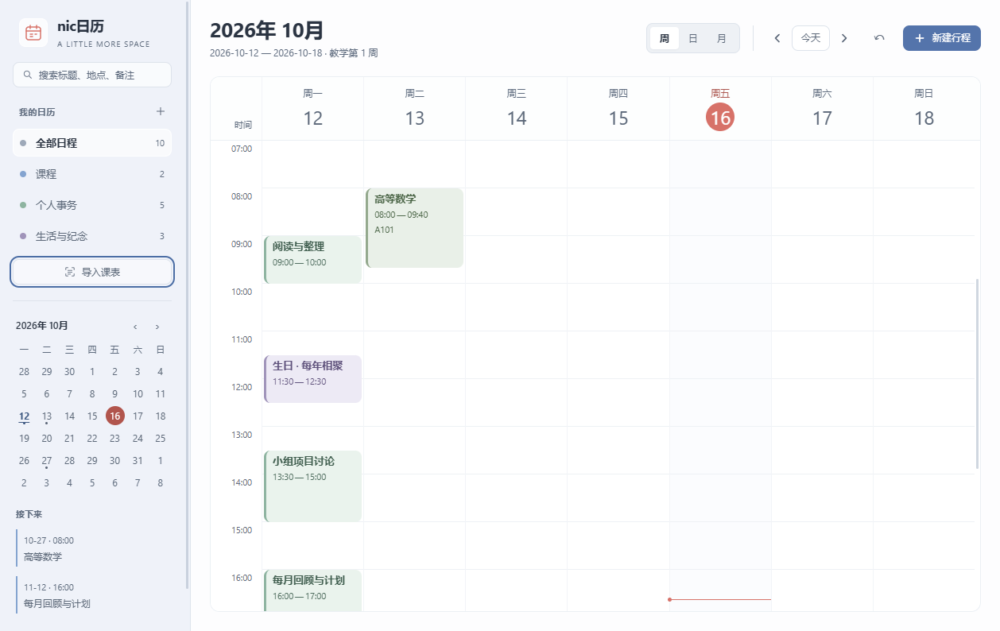
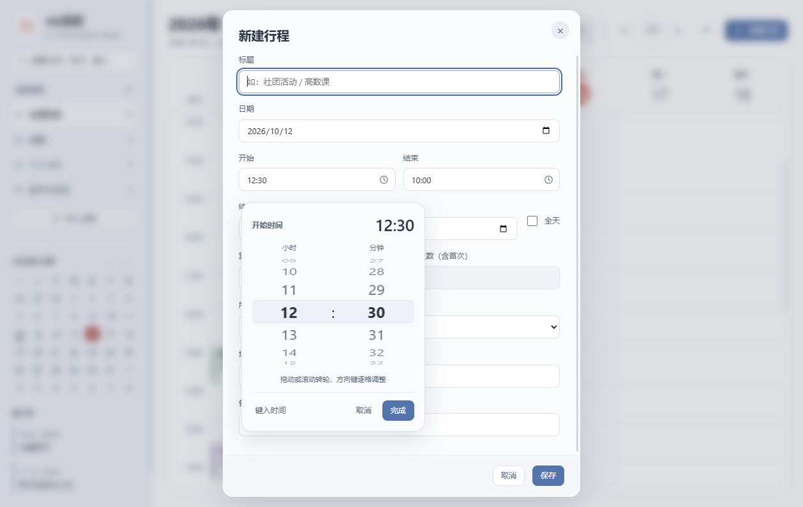

<p align="center"></p>

# nic日历

给课程与生活，一点有序的空间。

一款适用于 Windows 的本地日历应用。用清爽的日、周、月视图整理课表、日程、生日和纪念日，支持本地 OCR 与课表导入。

**[下载 Windows 安装版](https://github.com/nicklinnn-19/nic-calendar/releases)** · [使用说明](使用指南.md) · [反馈问题](https://github.com/nicklinnn-19/nic-calendar/issues)

当前版本：**0.3.8（Windows 安装版，测试阶段）**。此仓库只提供程序下载、使用说明与版本记录；项目自有源码暂不公开授权。



截图中的课程与日程为演示数据。安装包不包含个人资料；没有旧资料的新安装为空白日历，升级会沿用原资料。

本次发布：[安装更新与资料保留验证报告](UPDATE_REPORT.md)。新增安装版自动更新，并包含单条日程提醒、短卡片、关闭图标与滚动边界修复。历史构建瘦身见[此前报告](OPTIMIZATION_REPORT.md)。

## 可以做什么

- **整理日程**：日、周、月视图，搜索、地点、备注、全天与跨天安排。
- **安排课程**：按教学周、单周或双周导入；相同课程稳定配色；完全一致的课程视觉合并，真实冲突并排显示。
- **灵活调课**：修改一堂课时，可选择仅此周调整或应用到整个学期。
- **记住重要日子**：普通日程按公历每天、每周、每月或每年重复；可设置 2—600 次，含首次。
- **自建日历分类**：为生日、纪念日、工作等建立自己的日历并选择颜色。
- **本地识别**：从图片、PDF、Word、Excel 整理课表和上课时间，识别结果可核对、修正后再导入。
- **细致交互**：支持拖动、滚轮、键盘和直接输入的双列时间转轮。
- **系统提醒**：单条日程可选择关闭、准时或提前5／10／15／30／60分钟；默认15分钟，托盘后台继续通知。
- **安装版更新**：后台下载新版，由你确认重启；更新前备份，原行程和设置保留。
- **本地保存与备份**：托盘提醒、可选开机启动、自动本地备份，以及备份导出和恢复。

## 下载与运行

1. 打开 [Releases](https://github.com/nicklinnn-19/nic-calendar/releases)，下载 `nic-calendar-0.3.8-windows-x64-setup.exe`。
2. 先保存并从托盘退出旧版，运行下载的安装包。无需安装 Node.js、Git 或开发环境。
3. 安装后使用“nic日历（安装版）”快捷方式。有旧资料时自动沿用；同时发现自用版与公开版两份资料时，由你选择继续使用哪份，不自动合并或覆盖。

适用平台：**Windows 10 / 11，64 位 x64**。当前没有 macOS、Linux 或 ARM64 专用构建。

旧 ZIP 版需首次手动运行安装包一次；以后可在“偏好设置 → 应用更新”检查更新。下载完成后由你选择“重启并更新”，有未保存编辑时会阻止重启。GitHub 的 “Source code” ZIP/TAR 只包含本仓库说明文件，**不是可运行程序**。

本测试版尚未进行商业代码签名，Windows 可能显示“未知发行者”。发行页附有 `SHA256SUMS.txt`，可用于核对文件是否与发行包一致。

```powershell
Get-FileHash .\nic-calendar-0.3.8-windows-x64-setup.exe -Algorithm SHA256
```

## 数据与提醒

日程保存在本机原资料目录：公开版为 `%APPDATA%\nic-calendar\`，早期自用版为 `%APPDATA%\my-calendar-desktop\`。安装版沿用所选资料位置，后续更新继续使用同一份资料；不会自动合并、清空或重新排课。更新前自动备份，卸载程序也保留资料。

OCR 所需引擎与中英文模型随包提供。应用没有账号注册和云同步；日程及OCR文件不会上传。安装版会访问GitHub检查和下载更新。详见[隐私说明](PRIVACY.md)。

关闭窗口后程序保留在托盘，右键托盘选择“退出”才会停止。提醒需要程序运行且 Windows 允许通知，关机后不提醒。开机启动默认关闭。

## 使用前了解

- 这是公开测试版，重要日程请定期导出备份。
- OCR 结果取决于清晰度和表格排版，请核对学校作息、教学第 1 周的星期一、总周数与单双周后再导入。
- 生日和纪念日目前支持公历；不支持农历或无限次数重复。
- 首次从旧ZIP版转为安装版前，建议先导出备份并退出旧版；以后在应用内选择重启更新，程序会先保留升级备份。



## 反馈与许可

通过 [Issues](https://github.com/nicklinnn-19/nic-calendar/issues) 反馈问题。请描述操作步骤、应用版本、Windows 版本及缩放比例。截图前遮住私人日程；不要上传完整日历备份或个人课表原件。

本程序允许下载并运行。项目自有代码和素材保留权利，未授权使用、修改或再分发；详见 [LICENSE.txt](LICENSE.txt)。第三方组件遵循各自许可，见 [THIRD_PARTY_NOTICES.md](THIRD_PARTY_NOTICES.md)，完整文本随发行包提供。

与 Apple 无隶属或关联关系。

