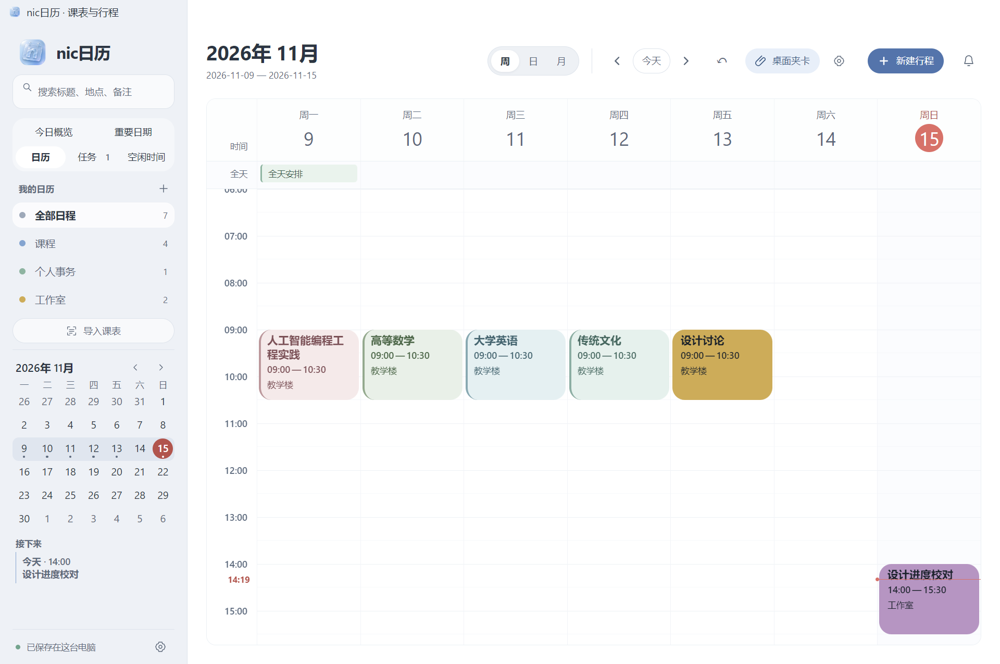
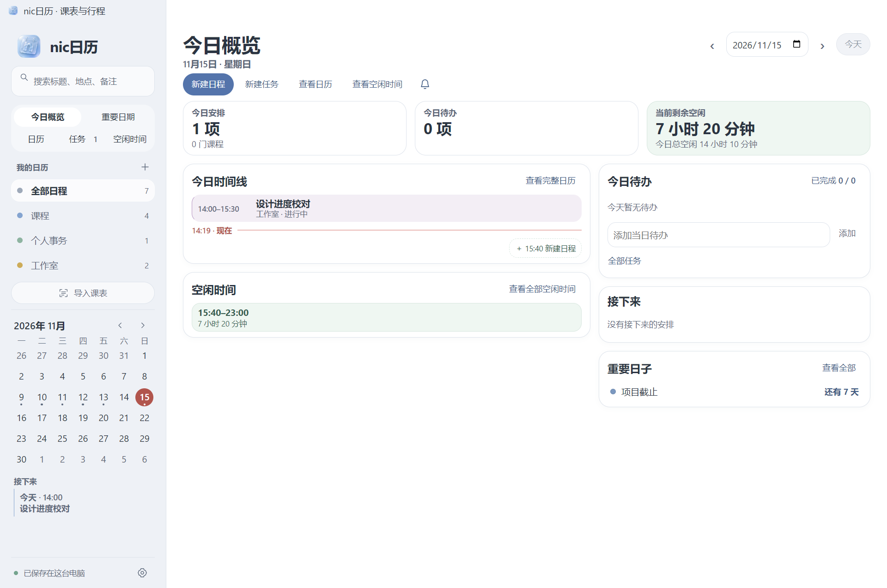
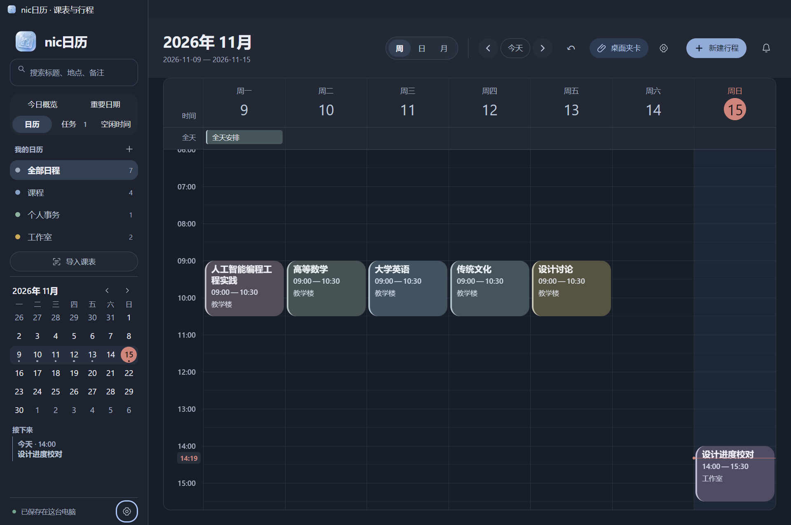

<h1 align="center">nic日历</h1>

给课程与生活，一点有序的空间。

在 Windows 桌面整理课表、日程、待办和重要日子。

<strong><a href="https://github.com/nicklinnn-19/nic-calendar/releases/download/v0.6.0/nic-calendar-0.6.0-windows-x64-setup.exe">下载 Windows 安装版</a></strong> · <a href="https://github.com/nicklinnn-19/nic-calendar/releases/tag/v0.6.0">查看 0.6.0 更新</a> · <a href="使用指南.md">使用说明</a>

周视图 · 课程、个人安排与当前时间一目了然

## 把一周安排看清楚

- **课表和日程放在一起。** 日、周、月视图展示不同时间尺度，自定义日历和颜色帮助区分课程、工作与生活。
- **按真实学期安排课程。** 导入课表时设置教学周、节次和单双周。课程变动时可选择调整本次或后续安排。
- **直接在时间轴上安排。** 拖动日程、在空白处创建事项，悬停卡片查看完整信息。打开日、周视图时自动定位到值得关注的时间段。

## 从今天开始安排

今日概览 · 今天要做什么、什么时候有空，都在同一页

- **先看今天。** 概览集中显示当日安排、待办进度、剩余空闲和接下来的事项。
- **把待办安排进日历。** 记录截止日期、优先级、预计耗时、标签和子任务。空闲时间页面根据现有安排推荐可用时段，确认后创建日程。
- **记住重要日子。** 为生日、纪念日或考试设置日期和倒数，放到桌面夹卡，随时看见。
- **需要提醒时及时收到。** 为日程和任务设置提醒，程序在系统托盘运行时可以继续发送 Windows 通知。

## 让桌面适合自己的节奏

深色模式 · 保留清晰的时间刻度与日历颜色

支持浅色、深色与跟随系统。桌面夹卡可以显示下一项或今日安排，也可以挂起关注的事项，自由拖动并记住位置。启用天气后，日历和今日概览可以显示所选城市的天气，逐小时预报支持横向浏览。

图片来自隔离测试环境，课程和日程均为演示数据。

## 导入、备份与更新

- 从图片、PDF、Word 或 Excel 整理课表，使用本地 OCR 识别后可核对和修改。
- 导入 ICS 日历时可预览并选择项目，也可以按日历或日期范围导出。
- 日程和设置保存在本机。支持导出备份与恢复，安装版更新前会备份现有资料。
- 天气功能需要联网，并在设置中填写自己的和风天气 API Host 与凭据。应用内可选择城市并测试连接。

## 下载与安装

当前公开版本为 **0.6.0**，适用于 **Windows 10 / 11 x64**。

1. 下载 [nic-calendar-0.6.0-windows-x64-setup.exe](https://github.com/nicklinnn-19/nic-calendar/releases/download/v0.6.0/nic-calendar-0.6.0-windows-x64-setup.exe) 并运行安装程序。
2. 从旧版升级时，先保存编辑并从系统托盘退出旧版。安装版也可在「偏好设置 → 应用更新」检查新版。
3. 如果发现公开版与早期自用版两份资料，安装版会让你选择继续使用哪一份。

安装包未进行商业代码签名，Windows 可能显示未知发行者。发行页提供 SHA256SUMS.txt 用于核对下载文件。GitHub 的 Source code 压缩包是本仓库的说明文件，运行程序请下载上面的安装包。

## 数据与提醒

日程保存在 Windows 用户资料目录中。应用无需账号，OCR 在本机运行。天气查询和检查更新需要联网。提醒需要程序运行且 Windows 允许通知，退出托盘或关机后提醒停止。[隐私说明](PRIVACY.md)

## 反馈与许可

欢迎在 [Issues](https://github.com/nicklinnn-19/nic-calendar/issues) 反馈使用问题或建议。反馈时请描述操作步骤、应用版本和 Windows 版本，截图请遮住个人日程。

本仓库提供程序下载、使用说明与版本记录。项目自有代码和素材保留权利，详见 [LICENSE.txt](LICENSE.txt)。第三方组件遵循各自许可，详见 [THIRD_PARTY_NOTICES.md](THIRD_PARTY_NOTICES.md)。
